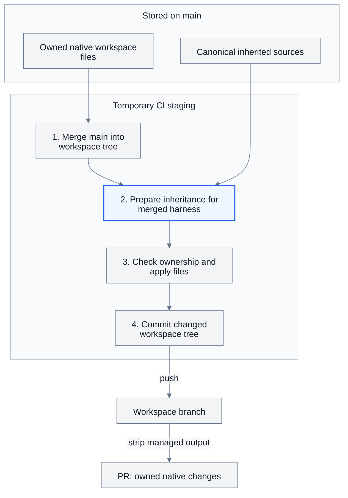

# Delphi — Design

Goals: `docs/goals.md`. No CLI: plain git plus a few shell scripts run by GitHub Actions.

## 1. Model

`main` holds each workspace's owned files in `software/**/workspaces/<leaf>/`, at their native
harness paths (declared in `ci/harnesses/<name>.sh`). A workspace's `<name>` is the short name
of each folder from `software/` down to its project folder, then `<leaf>`, joined by dots
(`s.app.argos.argos-dev` for `software/application-software/argos/workspaces/argos-dev`). A folder's
short name is the one line in its `short-name` file, else its own name; `.delphi/names.sh [<rev>]`
prints every workspace's name and folder, and every script that names workspaces uses it. Short
names and leaves are lowercase letters, digits and `-`, so a name is always a valid ref and a flat
folder name (`workspaces/<name>`, `.delphi/parked/<name>`), and no branch can be a folder of another. For each workspace, branch
**`ws/<name>`** has **that folder as its repo root**. Two directions keep them in sync, both subtree
merges (`git merge -Xsubtree=<folder>`), so the histories stay joined and edits on either side meet
in normal three-way merges. The one thing shared is main's root `.delphi/` (the scripts): sync
puts it at the root of every `ws/*` branch, so it is on every branch, main included, and is edited
only on main. Shared context lives once in canonical sources on main. CI prepares inherited native
files in temporary staging; refresh adds them only to `ws/*`. Each workspace explicitly selects
its `harness:`, independently of a source bundle's `format:`. A project's `workspace-defaults/`
seeds owned files once at creation. Proposals return owned changes and omit managed inheritance.
`workspaces:` checks out other branches to read, and harness plugins carry optional capabilities.

```
   ┌───────────────────────────────┐
   │ main                          │
   │ software/…/workspaces/<name>/ │
   └───────────────────────────────┘
        │                  ▲
        │ refresh          │ merge PR
        │ (CI)             │ (after check.sh)
        ▼                  │
   ┌──────────────────┐  ┌──────────────────┐
   │ ws/<name>        │  │ propose/<name>   │
   │ root = workspace │─►│ PR to main       │
   └──────────────────┘  └──────────────────┘
        │         ▲    propose (CI)
        │ branch  │ merge PR
        ▼         │
   ┌──────────────────┐
   │ your branch      │
   │ edit · commit    │
   └──────────────────┘

   refresh: main → ws/<name>        (folder becomes root)
   propose: ws/<name> → main PR     (root goes back under folder)
   CI runs both on every push to main or ws/**
```

## 2. Repository (main)

```
software/<org>/…/<project>/           project context and optional workspace-defaults/ source bundle
software/[<org>/…/]workspace-inherit/  existing native sources, including .claude/skills/<name>/
software/<org>/…/plugins/<harness>/<set>/   a plugin set for the workspaces under that folder (optional, main only)
software/<org>/…/short-name           the folder's short name in workspace names (optional; default: its name)
software/<org>/…/plugins/scope        its scope in plugin names (optional; default: its short name)
.claude-plugin/marketplace.json       every Claude Code plugin set under software/ (generated)
software/<org>/…/workspaces/<leaf>/   workspace.yml and owned native files; no inherited copies or ledger
.delphi/                              {setup,new-worktree,switch,park,plugins,version}.sh  manifest.yml  versions
                                      migrations/  .gitattributes  .gitignore: on every ws/* root
ci/sync.sh  ci/check.sh               CI scripts
ci/harnesses/                        one native contract per registered target or source format
ci/harnesses.sh  ci/sources.sh       registry queries and independent source reader
ci/inherit.sh  ci/render.sh          source resolution and temporary native staging
ci/managed.sh                        ownership records; shared with branch sync
ci/plugins.sh                         writes the marketplace and each workspace's .claude/settings.json
tools/new-workspace.sh                new workspace as a PR
templates/workspace/                  common workspace template
templates/harnesses/                  other adapters' native instruction templates
.github/workflows/delphi.yml          CI
tests/e2e.sh                          sandbox test of all of the above
```

Org folders under `software/` are plain directories. `workspace.yml` is tiny YAML: `name:` (the
workspace's name, so a checkout of `ws/<name>` knows which workspace it is), `harness: <adapter>`, an
optional `repos:` map of `<name>: <git-url>`, and an optional `references-git:` map of
`<name>: <git-url> [<ref>]` (names unique across both maps), and an optional `workspaces:` list of
`- <name>` (a workspace on main) or `- main` (no duplicates, not itself). `name:` must be the one
`names.sh` gives, and names are unique (a clash is fixed with a `short-name`). Workspaces never nest; no symlinks under
`software/`. The root `.delphi/` holds the scripts and the version files (section 5b), and no
workspace folder (nor the template) has a `.delphi/` of its own. Each manifest file outside
`.delphi/` (the workflow) is the same at main's root, in the template, and in every workspace. `ci/check.sh` enforces all of this and lists every problem.
`.gitattributes` (`eol=lf`, in `.delphi/` and each workspace) keeps the scripts runnable in Git Bash
clones.
`.github/CODEOWNERS` assigns reviewers per org folder.

The folder holding `workspaces/` is a project folder. Its optional `workspace-defaults/` seeds
workspace-owned files once. Any ancestor org or project may provide managed `workspace-inherit/`
files. Existing Claude skills stay under `workspace-inherit/.claude/skills/` with their metadata
intact. A source bundle is Claude-authored unless its optional `source.yml` declares another
`format:` from the harness registry. Source metadata is never copied into a workspace.
A defaults manifest's optional `harness:` suggests a creation target; every workspace records its
own explicit target.

`ci/render.sh` prepares inheritance from a main checkout into temporary staging. `ci/inherit.sh`
selects ancestor sources, `ci/sources.sh` maps paths, and `ci/harnesses.sh` adapts target content.
Each payload is prepared once, then hashed and copied from those same bytes. Claude skill content
passes through unchanged. Each harness descriptor owns `translate_skill`: it converts metadata,
workspace identifiers and capability-specific bullets. Codex uses `$skill` calls and wraps literal
`bash scripts/...` commands with `.delphi/exec.sh`. Claude identifiers are defined in its descriptor;
non-Claude output with an unmapped identifier fails validation and names the target and source.
Qualified code-repository paths stay literal. Helper scripts pass through unchanged.

`ci/render.sh [--check] [--workspace <folder>] [<main-checkout> [<staging-output>]]` updates plugin
output by default. An optional staging destination receives inherited native files and ownership
ledgers without adding them to main. `--workspace` selects one workspace; `--check` validates
without changing the main checkout. `ci/check.sh` rejects committed inherited copies, ledgers,
ownership collisions and invalid sources, and checks generated plugin settings.

On `ws/*`, `workspace.generated` records managed destinations, origins, modes and native hashes.
Edit sources instead of managed copies. `opt-out:` transfers a native file or folder to workspace
ownership; that copy can return to main through a proposal. Managed output and its ledger exist
only in staging and workspace branches. Ownership checks protect owned additions and report
ambiguous edits or retirements. Inheritance cannot replace workspace identity, root instructions,
runtime or workflow files.
When changing a workspace's harness, update its owned native files too; CI regenerates inheritance.

Source-native `opt-out:` paths are applied before mapping, so a Codex workspace can exclude a
Claude-only input such as `.claude/commands`. Mapped native opt-outs still transfer copies to
workspace ownership. Unsupported native mappings fail unless explicitly excluded. Refresh merges
the manifest before rendering, so a new source and its exclusion can arrive together.

Shared-source paths, generated ledger paths and opt-out keys accept only ASCII
`[A-Za-z0-9._/@+-]`. Spaces and control characters are unsupported; paths must be relative without
`.`, `..` or `.git` components. This restriction does not apply to workspace-owned filenames.



The blue step runs after the merge, using its manifest to select the harness and opt-outs.
`stage_inheritance()` calls the renderer; `apply_inheritance()` checks ownership and installs the
prepared bytes. Historical output may be replayed to verify prior ownership. Proposals discard
staged inheritance and return owned files in their existing native format.

A plugin set is for what `workspace-inherit/` can't do: context only some workspaces opt into, or
harness features beyond files (hooks, MCP servers). It lives in `plugins/<harness>/<set>/` of a
folder (`plugins/claude/` for Claude Code; a sister folder per other harness), one copy for the
workspaces below. The one so far is `delphi`, `software/`'s `default` set (scope `delphi`): a mod
(section 5) whose `/ws-delphi` pane switches workspaces. Every Claude Code workspace gets the
`default` set of each folder above it, which `ci/plugins.sh` lists first under `plugins:` in its
`workspace.yml` (`- argos   # default, from software/application-software/argos/`; a removed line
comes back); other sets are listed there by hand (`- <scope>.<set>`). `ci/plugins.sh` generates the
rest, and `ci/check.sh` fails if the list or either file is out of date:

- `.claude-plugin/marketplace.json` at main's root: marketplace `delphi`, one plugin per set, named
  `<scope>` for a folder's `default` set and `<scope>.<set>` for the others (`argos`,
  `argos.testing`), so names stay short in Claude Code's `/` menu. A folder's scope is the one line in
  its `plugins/scope`, else its short name (`application-software`'s `short-name` is `app`), else its
  own name. Scopes are lowercase
  letters, digits and `-`, unique across the tree, and each `plugin.json` uses its name. (Claude
  Code refuses `/` in plugin names; `.` works, though Claude.ai's marketplace sync wants kebab-case.)
- Each `harness: claude-code` workspace's `.claude/settings.json`: the shared settings in
  `ci/plugins.sh`, plus the `delphi` marketplace (with `autoUpdate`) and the sets under `plugins:`
  in `enabledPlugins`. Never edit it by hand: personal settings go in `.claude/settings.local.json`
  (git-ignored by Claude Code), shared ones in `workspace.yml` or the generator. Main's settings
  are generated before their PR merges into main. Refresh generates branch settings from its plugin selections and
  main's plugin catalog, so enabled sets remain active while their proposal to main is pending.
- Enabled isn't installed: Claude Code only offers to install a project's enabled plugins, so
  someone may never have installed a set, and then its skills are silently missing; and a set that
  leaves the marketplace stays installed, failing to load. So `setup.sh` (on every setup, switch and
  pull) runs `.delphi/plugins.sh`, which makes this clone's `@delphi` plugins what the workspace's
  `settings.json` enables: it installs the ones it enables but this root lacks (`claude plugin list
  --json`: user scope, or project or local scope for this root) with `claude plugin install <plugin>
  --scope local`, which leaves the generated file alone; uninstalls this root's local installs it
  doesn't enable (a local install is per folder, not per workspace, and the git-ignored
  `.claude/settings.local.json` keeps it enabled after a switch, so it would load in the next
  workspace); and uninstalls, at any scope, installed ones Claude Code marks `plugin-not-found` in the
  Delphi marketplace. Other clones' installs and user-scope plugins the marketplace still has are
  never touched. It refreshes the marketplace first, only before installing or uninstalling what it
  dropped; offline it does only the local uninstalls and warns, as it does for other marketplaces'
  plugins. So switching back reinstalls, and renaming,
  splitting or dropping a set needs no migration: every clone catches up on its next pull or switch.
  (`delphi` at `--scope user` also has `/ws-delphi` on `main` and in every clone.)

Claude Code installs a plugin from `main` by copying only its folder, so it can't use files outside
it; at run time its skills read the workspace as usual. With no `version`, each commit to `main`
that touches a set is an update.

## 3. Sync (`ci/sync.sh [refresh|propose] [<name>]`; no direction = both)

For every workspace on `origin/main` (or just `<name>`):

1. **Merge** main into the workspace tree in a temporary checkout. Owned-file conflicts are
   reported. Managed-file conflicts can be deferred using ownership metadata, then verified
   against trusted source history before publication.
2. **Prepare inheritance** once from main's sources and the merged manifest. The registered
   harness maps paths and converts skill content; Claude copies its original bytes. Ownership
   checks protect local files and retired edits before prepared output and `workspace.generated`
   are applied. Sync adds main's `.delphi/`, commits only a changed tree, then pushes `ws/<name>`.
   A missing workspace branch starts from its main folder and gets the same preparation step.
   Branch plugin selections remain active while their proposal is pending.
3. **Propose** merges the workspace into a temporary main candidate, verifies ownership and strips
   managed inheritance, `workspace.generated` and the branch runtime. Owned files and opted-out
   copies remain native. It regenerates settings, runs `ci/check.sh`, and updates `propose/<name>`
   only when the tree changes. Existing PR labels are preserved.

History stays joined through subtree merges; workspace branches are never force-pushed. Legacy
path-named branches still carry over into dotted names while ahead, and receive the result once;
otherwise they are kept with a notice. Removed workspace branches are kept with a notice too.
An unchanged result leaves the workspace ref untouched. Renaming an org or project folder while
keeping its dotted workspace name preserves ownership history. Sync aligns the common ancestor's
folder prefix before merging a move, so later owned edits still use their original merge base.
Preparation commits stay temporary: each changed refresh publishes one merge parented by the
original workspace tip and main; proposals likewise use the actual workspace tip.

A conflict or failed render/check is reported and that workspace is skipped; other workspaces keep
syncing and the command exits 1. All work happens in temporary worktrees.

## 4. Working on a workspace

1. Clone or check out `ws/<name>` (it is the workspace root); run `.delphi/setup.sh` once.
2. Branch, commit, push, open a PR into `ws/<name>`. Update with `git merge origin/ws/<name>`.
3. After it merges, CI proposes it; merge that PR with a merge commit or squash, never rebase
   (rebasing replays folder-rooted commits onto main). CI then refreshes `ws/<name>`.
4. On a sync conflict: on a branch cut from `ws/<name>`, `git merge -Xsubtree=<folder>
   origin/main`, resolve, and PR it into `ws/<name>`.

Nobody pushes to `ws/*` or `main` directly (branch protection; CI's token is the exception).

## 5. `.delphi/setup.sh` (on every branch; does nothing on main, which has no `workspace.yml`)

First runs the workspace's pending migrations (section 5b). Then reads `repos:` from `workspace.yml` and, for each not yet present, clones it at
`repos/<name>/`, a plain clone of its own. Separately, it fetches the repo into a bare store at
`worktrees/<name>/.bare/` and checks out its default branch as the first worktree,
`worktrees/<name>/<default-branch>/` (re-created if missing), so it's there to see and branch from.
Worktrees come only from that store, so they never touch the clone (a branch can be checked out once
per repository, and the two are separate repositories). Adds the folders `park.sh` parks
and `.DS_Store` to the clone's `.git/info/exclude` once. For each repo under `references-git:` (read-only dependency
sources), it fetches `<ref>` (default: origin's `HEAD`) with `--depth 1` into `references/<name>/`,
checks it out detached, disables pushes, and does this again on every run, so the copy tracks its pin;
a failed fetch is reported and the old copy kept. Adds `/references/` to the exclude too; references get
no clone in `repos/` and no worktrees (`new-worktree.sh` refuses them). Each entry under `workspaces:` (`- <name>`
or `- main`; the workspace itself is skipped) gets a full clone of the clone's own origin at
`workspaces/<name>/`, on that branch (`ws/<name>` or `main`) tracking origin, so it behaves as a normal
checkout (`git status` shows its branch). Every run switches it back to that branch if it was switched
away (with its own `.delphi/switch.sh`, which refuses over uncommitted changes) and pulls it
(`--ff-only`), then runs its own `setup.sh`, so the linked workspace's repos and references are there
as in its own clone (main has nothing to set up). A workspace that is itself another's
`workspaces/<name>/` (setup.sh sees a Delphi workspace two folders up) skips its own `workspaces:`, so
setups never chain. A failure is reported and the clone left as it is. By convention a workspace reads its
links and doesn't edit them; `/workspaces/` is excluded too.
Links are separate clones, not worktrees of the Delphi clone, so two workspaces can both link `main`
and each copy parks with its workspace. Writes the clone's `post-checkout` hook, a 3-line script that
runs `.delphi/park.sh` from the worktree that checked out (replacing an older link to or copy of a
`park.sh`), unless another hook is there (it says so and leaves it). `.delphi/` is on every branch, so
the hook always runs the `park.sh` just checked out, never a stale copy, and each worktree of the clone
its own: the worktrees share one hook, so a link would run one checkout's `park.sh` for all of them. Nothing else. Must run on macOS `/bin/bash` 3.2
and Git Bash: no bash-4 features, POSIX awk only.

`.delphi/park.sh` (the hook) lets one clone switch freely between workspaces and `main`. When a
branch checkout changes the `name:` in `workspace.yml` (none on `main`), it moves the old
workspace's root folders to `.delphi/parked/<name>/`: the ones `.delphi/paths.sh` names, `.journal/`,
and those under `park:` in the `workspace.yml` of the branch it leaves, so each workspace chooses its
own (a project's `workspace-defaults/` can start the list). It moves back everything parked for the
new one, whatever its list says now. Entries are folder names at the root, never `.git` or `.delphi`:
`ci/check.sh` checks them and `park.sh` skips a bad one. An old name (a folder path, from before dotted names) is the same
workspace as the dotted name ending in its last part, so moving a clone onto its renamed branch moves nothing.
`.delphi/.gitignore` ignores `parked/`; since `.delphi/` is on every branch, so is that rule. Parked
work is ignored, not hidden: `git clean -X` or `git stash --all` at the root would take it. A move is a rename, so it is instant and every
absolute path (worktree links, build caches) is the same again whenever its workspace is checked
out; nothing is repaired or rebuilt. Branches of the same workspace move nothing. It never
overwrites: a folder in the way is reported and the other copy stays parked.

`.delphi/new-worktree.sh <repo> <branch> [<base>]` creates or reuses `worktrees/<repo>/<branch>`
from the store at `worktrees/<repo>/.bare`: checks out an existing branch, else starts one from `<base>` (default `origin/HEAD`). Same shell rules.
The inherited `new-worktree` skill makes worktrees the default way to start a branch.

`.delphi/paths.sh` is the layout in one place: sourced, it sets and exports `DELPHI_ROOT` (from the
file's own place) and `DELPHI_REPOS`, `DELPHI_WORKTREES`, `DELPHI_REFERENCES`, `DELPHI_WORKSPACES`; run,
it prints them as an export line. The adapter supplies layout initialization: for Claude Code, a SessionStart hook in `.claude/settings.json` (from
`ci/plugins.sh`) appends it to `$CLAUDE_ENV_FILE`, which reaches the model's commands, subagents' and
skill scripts'. In a terminal, `. .delphi/paths.sh` from the root. `new-worktree.sh` sources it from
its own folder; every skill script, plugin or workspace, sources `$DELPHI_ROOT/.delphi/paths.sh` and
takes only names (repo, branch), never a searched-for path, so the model types only the names.
Codex uses `AGENTS.md` and `.agents/skills/` from its checked-out branch. Run helper commands through
`bash "<root>/.delphi/exec.sh" <command> ...`; it initializes the layout without changing the caller's
directory and exports it to children. Generated Codex skills use the full wrapper command for
helper calls. Fill its explicit root and installed-skill placeholders from the known checkout,
then use the same invocation in fresh shells and sub-agents. The host supplies
dependencies, credentials and integrations. `DELPHI_GITHUB_REST_PROXY` enables the shared helper's
REST-proxy fallback; existing Claude remote sessions retain their fallback.

`.delphi/switch.sh <workspace>|main` moves the clone to `ws/<workspace>` (or `main`): it refuses while
tracked files have changes, fetches the branch, switches (the hook parks and restores), fast-forwards
to origin, and runs the new workspace's `setup.sh`. `switch.sh --list` prints `main` and each workspace with a branch, as `<name> <project folder>`, `*` before this clone's. The `delphi` mod
(`software/plugins/claude/default/`) puts that in a pane to keep open: `/ws-delphi` shows them as cards grouped by project, this clone's
marked current, with a warning when tracked files have changed; pressing a card selects it, and
**Switch workspace** runs `switch.sh` (`/ws-delphi <name>` skips the pane). Codex sessions must
restart after a switch. Claude Code with this mod reloads skills from `.claude/skills/` itself, and the mod sends the root's new `CLAUDE.md` with the
next prompt (once, after any change: a switch, a pull, `switch.sh` by hand), saying it replaces the
one the session started with (a user mod can't rewrite the session's own `CLAUDE.md` block). All
the git work stays in `switch.sh`, which `tests/e2e.sh` covers; the mod's own tests
(`tests/ws.test.ts`, `claude plugin test`) stub its processes, and `tests/e2e.sh` runs them when a
real `claude` is installed. Optionally the same cards open in a browser tab: `/ws-delphi --web`, or the pane's
**Open in browser**, starts `web/server.py` (Python 3 stdlib) for the session on `127.0.0.1` at a
random port; it answers only requests carrying the token in its URL with a local `Host`, switches
only on a JSON `POST` (so no other page the browser has open can switch the clone), runs the same
`switch.sh`, and prints each switch, which the mod reads to update its pane. `tests/e2e.sh` runs the
real server against a sandbox clone. The inherited `switch-workspace` skill makes it
the way to work in another workspace; its `setup-workspace` skill covers `workspace.yml` (repos,
references, links) and re-running setup.

The inherited `journal` skill parks rough notes in `.journal/` at the workspace root (its
`capture.sh` adds `/.journal/` to `.git/info/exclude`) and exports them through other skills.

## 5b. Versions and migrations

Delphi's own files, the ones identical on main and every `ws/*` branch, are listed in
`.delphi/manifest.yml` (`files:`, itself included), under a `version:` that is MAJOR.MINOR.PATCH:
PATCH for fixes and wording, MINOR for something new that existing clones need nothing for, MAJOR
(MINOR while 0.x) when clones need cleanup. `.delphi/version.sh` prints `<version> <hash>`, the hash
covering the listed files' paths and contents as git stores them (line endings don't change it).
`.delphi/versions` has one line per version, `<version> <hash> <what changed>`, oldest first, and is
the one file in `.delphi/` outside the hash. `ci/check.sh` requires: the manifest lists itself and
every file in `.delphi/` but `versions`; the last line of `versions` is the current
`<version> <hash>` (so any change to a listed file, the manifest included, needs a new version);
versions rise; and, against main in CI, `versions` only gains lines and released migrations stay as
they are.

A version whose clones need cleanup ships `.delphi/migrations/<version>-<slug>.sh` and bumps MAJOR
(MINOR while 0.x; `check.sh` enforces it). `setup.sh` runs, oldest first, each migration above the
workspace's recorded version, `git config delphi.<name>.version` in the clone (`0.0.0` if unset),
from the workspace root, recording each as it succeeds and then the current version; it stops at
one that fails, so the next run retries it. Records are per workspace because the state migrations
fix sits in each workspace's own checkouts, parked ones included: a parked workspace migrates when
it's switched back to (`switch.sh` runs setup). Migrations must be safe to re-run, do nothing on a
fresh clone, and delete only what nothing is lost from, stopping with what to do otherwise. `setup.sh`
also warns when `.delphi/` isn't exactly the version it says (edited in the clone).

## 6. New workspaces

`tools/new-workspace.sh [--by <who>] [--harness <adapter>] <org-path> <leaf>` validates the leaf and
dotted name in a temporary main checkout. Explicit selection overrides the project's creation
suggestion, with Claude Code suggested when neither is supplied. The chosen harness is always
written into the workspace manifest. The source reader translates project defaults into that
harness's native paths, appends instruction defaults to its native template, fills placeholders,
and preserves ordinary defaults. Unsupported native mappings fail.

The tool runs `ci/render.sh` and `ci/check.sh`, then opens `new-workspace/<org-path>/<leaf>` as a
main-side PR with owned native files and a `by: <who>` label. After merge, CI creates `ws/<name>`
and adds staged inheritance there. Defaults are seeded once; inherited skills never enter the
creation PR.

### Adding a harness or source format

Add `ci/harnesses/<name>.sh` and the template its `instruction_template` field names.
Creation combines optional `instruction_base` with the harness's `instruction_template`, keeping
common layout authored once and the result an owned snapshot.
`ci/harnesses.sh` exposes pure `harness_field <name> <field>` queries; native, protected and foreign
paths are derived from the registered entries. The same registry recognizes source formats.
Define `translate_skill` in the descriptor; reuse Claude's identifier translator and the shared
bootstrap helpers where appropriate. New metadata formats belong in that function. Select the target in a workspace
manifest, validate staging, and run the sandbox suite. Ordinary targets need no renderer, validator
or sync changes. Add a capability implementation only when the target introduces one.

An optional `settings_generator` implements `settings <folder> <manifest>`; a file-only target
needs no generator. The entry also selects its helper bootstrap. Template locations are entry data,
so the existing Claude template stays where seed-once creation already reads it.

A new source format supplies the same file records (mode/hash, destination, origin) through
`ci/sources.sh`. It does not select a workspace's target. Creation suggestions and source formats
can change independently of existing workspaces. Runtime changes follow the normal version rules;
adding a harness does not require a particular host or account.

## 7. CI (`.github/workflows/delphi.yml`)

- `check`: PRs to main, read-only token, full history, runs `ci/check.sh . origin/main`.
- `sync`: pushes to main or `ws/**`; checks out main (scripts never come from a ws branch) with full
  history, sets the bot identity, runs `ci/sync.sh` (contents + pull-requests write; one run at a
  time).

GitHub runs a push's workflow from the pushed commit, so the same file sits at the root of every
`ws/<name>` (via the workspace folder). Pushes and PRs made with `GITHUB_TOKEN` trigger no
workflows: no loops, and CI-opened PRs don't run `check`, which is why sync runs `ci/check.sh`
itself (so `check` can't be a required status check).

## 8. Testing

`tests/e2e.sh` builds a sandbox (temp dir, bare origin, stub `gh` logging to `gh.log`, two
workspaces in different org folders) and drives the scripts as CI and people would. Never test
against GitHub.
